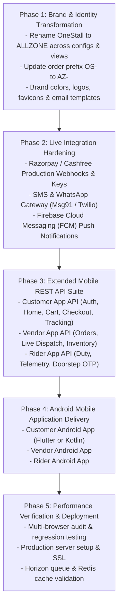

# ALLZONE - Complete Existing Project Technical Audit & Conversion Blueprint

> **Target Platform:** ALLZONE — Multi-Vendor E-Commerce Marketplace  
> **Source Codebase:** OneStall Omnichannel Hyperlocal & Multi-Vendor Marketplace  
> **Audited By:** Senior Software Architect  
> **Audit Date:** November 15, 2026  
> **Repository Location:** `C:\xampp\htdocs\allzone`  
> **Database:** MySQL 8.x / MariaDB (`allzone`) | SQLite 3 (In-Memory Testing)  
> **Framework & Runtime:** Laravel 12.0.x / PHP 8.2+ / 8.3 compatible  
> **Status:** **COMPLETE EXISTING PROJECT AUDIT & TRANSITION STRATEGY**

---

## 1. Executive Summary

This comprehensive audit inspects the existing multi-vendor e-commerce repository located in `c:\xampp\htdocs\allzone` with the objective of transitioning and upgrading it into **ALLZONE**, an enterprise-grade Multi-Vendor E-Commerce Marketplace.

The existing codebase is not a generic template or skeletal mockup; it is a **mature, production-ready, enterprise-grade hybrid commerce platform** that unifies two distinct e-commerce models into a single catalog and checkout experience:
1. **Hyperlocal Quick-Commerce (15–30 Minute Delivery):** Real-time geofenced store serviceability (Haversine formula), store operating hours, acoustic live order dispatch consoles for sellers, and dynamic rider assignment with live telemetry and doorstep OTP verification.
2. **National Multi-Vendor Courier Delivery (Cargo 3PL):** Multi-seller shipping, automated manifest creation, Air Waybill (AWB) generation, reverse logistics, Non-Delivery Report (NDR) workflows, Return to Origin (RTO), and Cash on Delivery (COD) remittances.

### Summary Metrics of Existing Codebase

| Metric | Measured Value | Architecture Status |
|---|---|---|
| **Framework Version** | Laravel 12.0.x | Modern / Latest LTS release |
| **PHP Compatibility** | PHP 8.2 & PHP 8.3+ | Strict types, Backed Enums, Readonly properties |
| **Database Tables** | **92 Tables** | Relational integrity, FK constraints, Composite indexes |
| **Database Migrations** | **70+ Migration Files** | Clean chronological schema evolution |
| **Eloquent Models** | **76 Models** | Encrypted casts for PAN/GST/Bank, SoftDeletes |
| **HTTP & API Controllers** | **75 Controllers** | Divided into Admin, Seller, Rider, Storefront, API |
| **Core Domain Services** | **72 Domain Services** | Thin controllers, dedicated business service layer |
| **PHP Backed Enums** | **38 Enums** | Type-safe state transitions across all entities |
| **Registered Routes** | **475 Routes** | 5 isolated route files (`web`, `admin`, `seller`, `api_v1`, `console`) |
| **Blade View Templates** | **110+ View Templates** | Responsive Tailwind CSS v4, Alpine.js v3, Chart.js |
| **Automated Test Coverage** | **66 Test Suites / 589 Tests** | **3,233 Assertions (100% Pass Rate in SQLite memory)** |
| **Native Android Apps** | **0 Native Projects Present** | Dedicated Mobile-First Web PWA present; REST API ready |

---

## 2. In-Depth Inspection of 14 Required Architectural Areas

---

### Area 1: Complete Laravel Project Architecture
- **Framework & Packages:**
  - `laravel/framework: ^12.0`
  - `spatie/laravel-permission: ^6.25` (Role-based access control across guards)
  - `spatie/laravel-activitylog: ^4.12` (System-wide audit logging)
  - `laravel/sanctum: ^4.3` (API token authentication)
  - `laravel/horizon: ^5.50` (Redis queue orchestration)
  - `maatwebsite/excel: ^3.1` (Batch CSV/Excel import/export)
  - `intervention/image: ^3.11` (Responsive product image & avatar processing)
  - `blade-ui-kit/blade-heroicons: ^2.7` (UI icons)
  - `barryvdh/laravel-dompdf: ^3.1` (GST tax invoices, packing slips, shipping labels)
  - `predis/predis: ^3.7` (High-performance Redis cache & queue driver)
- **Layered Code Organization:**
  - `app/Actions/`: Atomic reusable business actions.
  - `app/Console/`: Scheduled tasks (pruning expired inventory reservations, tracking sync).
  - `app/Enums/`: 38 Enums defining allowed states (`OrderStatus`, `FulfilmentStatus`, `PaymentStatus`, `SellerStatus`, `DeliveryAssignmentStatus`, etc.).
  - `app/Events/` & `app/Listeners/`: Asynchronous event propagation for order placement, stock changes, and dispatch alerts.
  - `app/Helpers/helpers.php`: Global helpers (`setting()`, `format_currency()`, `calculate_distance()`).
  - `app/Http/Controllers/`: 75 controllers partitioned into clear functional boundaries.
  - `app/Models/`: 76 Eloquent models with encrypted attributes for sensitive tax & banking records.
  - `app/Policies/`: Security authorization policies protecting multi-tenant seller isolation.
  - `app/Services/`: 72 domain services encapsulating business rules outside HTTP requests.
- **Architectural Strengths:**
  - No hardcoded business constants: Commission percentages, delivery radius, tax rates, and logistics fees are stored in the database `settings` table.
  - Strict financial accuracy: `decimal(12,2)` used across all monetary ledger tables.
  - Database transactional integrity (`DB::transaction`) wrapping multi-step stock deductions and wallet movements.

---

### Area 2: Frontend Pages & Website Design
- **Technology Stack:** Blade Templates + Tailwind CSS v4 + Alpine.js v3 + Chart.js via Vite 7.
- **Layout Architecture:**
  - Master Storefront Layout: [`resources/views/layouts/storefront.blade.php`](file:///c:/xampp/htdocs/allzone/resources/views/layouts/storefront.blade.php)
  - Base UI Components: [`resources/views/components/`](file:///c:/xampp/htdocs/allzone/resources/views/components/) (`product-card`, `page-header`, `stat-card`, `modal`, `tabs`, `table`, `order-status-badge`, `avatar`, `alert`).
- **Core Storefront Pages:**
  - **Homepage ([`resources/views/storefront/home.blade.php`](file:///c:/xampp/htdocs/allzone/resources/views/storefront/home.blade.php)):** Dynamic Hero banner carousel, quick-commerce banner ticker, visual category cards, trending flash sales, featured seller stores, recommendation carousels, and responsive footer.
  - **Catalog & Category Browser ([`resources/views/storefront/category.blade.php`](file:///c:/xampp/htdocs/allzone/resources/views/storefront/category.blade.php)):** Multi-level category filtering, price slider, brand filter, stock filter, sorting (price low-high, popularity, rating).
  - **Search Interface ([`resources/views/storefront/search.blade.php`](file:///c:/xampp/htdocs/allzone/resources/views/storefront/search.blade.php)):** Full-text search with live auto-suggestions, category filters, and AI query parser integration.
  - **Product Detail Page ([`resources/views/storefront/product_detail.blade.php`](file:///c:/xampp/htdocs/allzone/resources/views/storefront/product_detail.blade.php)):** Interactive image gallery, variant swatches (size/color), real-time pincode serviceability checker, delivery promise badge (15-30 Min Quick vs Courier 2-4 Days), Customer Q&A accordion, verified review submissions, and seller profile card.
  - **Quick Commerce Discovery ([`resources/views/storefront/quick/index.blade.php`](file:///c:/xampp/htdocs/allzone/resources/views/storefront/quick/index.blade.php)):** Geolocation store radar displaying open neighborhood stores within configured radius.
  - **Seller Store Directory ([`resources/views/storefront/stores.blade.php`](file:///c:/xampp/htdocs/allzone/resources/views/storefront/stores.blade.php), [`store.blade.php`](file:///c:/xampp/htdocs/allzone/resources/views/storefront/store.blade.php)):** Dedicated store storefront with store banner, operating hours, delivery radius badge, and store-specific catalog.
  - **CMS Pages ([`resources/views/storefront/cms-page.blade.php`](file:///c:/xampp/htdocs/allzone/resources/views/storefront/cms-page.blade.php)):** Dynamic content pages (About Us, Terms & Conditions, Privacy Policy, Shipping Policy, Return Policy).

---

### Area 3: Admin Panel (Command Central)
- **Portal URL:** `/admin` (Dedicated login screen at `/admin/login`)
- **Access Control:** Guarded by `role:super_admin|admin|support_admin` via Spatie Laravel-Permission.
- **Admin Layout:** Dark-mode responsive dashboard ([`resources/views/layouts/admin.blade.php`](file:///c:/xampp/htdocs/allzone/resources/views/layouts/admin.blade.php)).
- **Controllers in `app/Http/Controllers/Admin/`:**
  - `DashboardController.php`: Real-time platform KPIs, Gross Merchandise Value (GMV), order volume charts, top categories, CSV summary export.
  - `SellerController.php`: Seller lifecycle (New applications, document verification, PAN/GST review, bank verification, approve, reject with reason, suspend, reactivate, commission overrides).
  - `ProductModerationController.php`: Product catalog moderation queue (Approve, Reject with feedback, batch approval).
  - `CategoryController.php` & `BrandController.php`: Multi-level category tree manager, brand verification.
  - `InventoryController.php`: Cross-warehouse inventory tracking, stock movements, sync logs.
  - `OrderController.php`: Central order management console, order timeline, manual status override, tax invoices.
  - `PaymentController.php`: Transaction audit, payment gateway callback logs, manual & automated refund approval.
  - `SettlementController.php`: Seller escrow ledger, settlement batch generation, net payout calculation, payout confirmation.
  - `CommissionRuleController.php`: Tiered commission rules (Global default, category-specific, seller-tier specific).
  - `ReturnController.php`: Platform return requests, seller dispute arbitration, restock approval, forced refund trigger.
  - `StoreController.php`: Physical store outlet registry, delivery zone geofencing, GPS coordinates map view.
  - `DeliveryPartnerController.php`: Fleet management, rider onboarding, KYC approval (DL, RC, Aadhaar), duty toggle, payout ledger.
  - `CampaignController.php`, `CouponController.php`, `BannerController.php`: Promotional campaigns, coupon codes (cart % or flat, category restrictions, min spend), homepage carousel banners.
  - `StaffController.php`: Admin staff management, granular role & permission assignments.
  - `SettingController.php` & `ShippingSettingController.php`: Dynamic platform configuration (shipping fees, free delivery threshold, quick delivery radius, Cargo 3PL credentials).
  - `AuditLogController.php`: Full audit trail of admin and seller actions via `spatie/laravel-activitylog`.

---

### Area 4: Seller / Vendor Panel (Seller Studio)
- **Portal URL:** `/seller` (Dedicated login `/seller/login`, registration `/seller/register`)
- **Access Control:** Guarded by `EnsureSellerStatus` (`seller.status`) middleware to enforce active/approved seller standing.
- **Seller Layout:** [`resources/views/layouts/seller.blade.php`](file:///c:/xampp/htdocs/allzone/resources/views/layouts/seller.blade.php) with multi-store switcher, store status indicator (Open/Closed), and Web Audio API live chime for incoming orders.
- **Onboarding Wizard (6-Step Registration Flow):**
  - File: [`app/Http/Controllers/Seller/OnboardingController.php`](file:///c:/xampp/htdocs/allzone/app/Http/Controllers/Seller/OnboardingController.php)
  - Step 1: Mobile OTP and Email verification.
  - Step 2: Business identity (Company name, Legal entity type, GSTIN, PAN).
  - Step 3: Banking setup (Account number, IFSC code, account holder name).
  - Step 4: Primary store setup (Store name, address, latitude/longitude, delivery radius).
  - Step 5: Document upload (GST Certificate, PAN Card, Cancelled Cheque/Passbook).
  - Step 6: Review, summary verification, and submission for admin review.
- **Seller Operational Features:**
  - **Dashboard:** GMV metrics, active stores, order count, pending fulfillment orders.
  - **Catalogue Management (`ProductController.php`):** Create simple or variant products, multi-image upload with gallery reordering, attribute selection (Color, Size), pricing, cost price, and stock levels.
  - **Inventory Management (`InventoryController.php`):** View physical stock (`quantity_on_hand`), reserved stock (`quantity_reserved`), available stock, and trigger quick restock.
  - **Order Fulfillment (`OrderController.php`, `QuickOrderController.php`):**
    - Standard orders: Accept order -> Print packing slip -> Mark packed -> Generate shipping label -> Mark ready to ship.
    - Quick orders: Acoustic live console (`/seller/quick-orders`), 15-minute fulfillment countdown, acoustic audio alert, store accept -> pack -> assign nearby delivery rider -> dispatch handover.
  - **Shipments & Logistics (`ShipmentController.php`):** Bulk shipping label printing, Cargo 3PL manifest generation, courier tracking.
  - **Settlements & Payouts (`PaymentController.php`):** View earned commissions, escrow balances, completed settlement batches, and downloadable payout slips.
  - **Third-Party Store Integrations ("Connect My Shop"):** Integrates Shopify, WooCommerce, and CSV catalog imports for automated inventory synchronization (`ConnectionController.php`).

---

### Area 5: Customer Panel
- **Authentication:**
  - Standard Email & Password (`CustomerAuthController.php`)
  - Passwordless Mobile OTP Login (`OtpAuthController.php`)
  - Customer Registration with phone/email verification (`customer-register.blade.php`)
  - Password reset via secure tokens (`PasswordResetController.php`)
- **Customer Account Features:**
  - **My Orders (`/orders`):** Order history, fulfillment order breakdown, item status badges, order tracking.
  - **Order Details (`/orders/{order_number}`):** Itemized breakdown, shipping address, payment method, tax invoice PDF download (`OrderPdfService.php`).
  - **Live Delivery Tracking (`/orders/{order}/live-tracking`):** Real-time GPS tracking interface for quick-commerce orders showing rider's current coordinates.
  - **Self-Service Order Management:**
    - Instant order cancellation prior to dispatch with automated wallet refund.
    - Partial item cancellation.
    - Self-service return filing with return reason selection and image proof upload (`/orders/{order_number}/return-item/{item_id}`).
    - Track return progress and reverse pickup.
  - **Address Book Management:** Multiple addresses (Home, Work, Other), GPS location auto-detect, default address toggles.
  - **Customer Wallet (`/wallet`):** Stored balance from refunds, instant checkout deduction, ledger of wallet transactions.
  - **Notification Center (`/notifications`):** In-app notification center, unread count badge, notification channel preferences (Email, SMS, WhatsApp, Push).

---

### Area 6: Existing Rider / Delivery Module
- **Portal URL:** `/rider` (Dedicated mobile-friendly web application)
- **Controllers & Services:**
  - Controller: [`app/Http/Controllers/Rider/RiderController.php`](file:///c:/xampp/htdocs/allzone/app/Http/Controllers/Rider/RiderController.php)
  - Service: [`app/Services/Rider/RiderEarningsService.php`](file:///c:/xampp/htdocs/allzone/app/Services/Rider/RiderEarningsService.php)
- **Views in `resources/views/rider/`:**
  - `login.blade.php`: Mobile phone & PIN / OTP login.
  - `register.blade.php`: Rider self-onboarding with vehicle selection.
  - `index.blade.php`: Rider dashboard with On-Duty / Off-Duty toggle, active assignment banner, earnings summary.
  - `assignment.blade.php`: Live delivery screen with pickup store address, navigation button (Google Maps / OpenStreetMap), order packing list, and delivery customer details.
  - `history.blade.php`: Past completed and cancelled deliveries.
  - `wallet.blade.php`: Rider earnings wallet, per-trip payout breakdown, total balance, payout requests.
  - `kyc.blade.php`: Upload Aadhaar card, Driving License, and Vehicle Registration Certificate (RC).
  - `profile.blade.php`: Rider profile management, avatar photo upload/replace/remove, vehicle details, password update, sign-out modal.
- **Rider Verification & Telemetry Workflow:**
  - On-Duty toggle updates `delivery_partners.is_online`.
  - Automatic rider assignment to pending quick-commerce orders.
  - Rider accepts/rejects assignment within timeout.
  - Rider arrives at store -> Marks order picked up (`/orders/{assignment}/pickup`).
  - Rider arrives at customer doorstep -> Requests 4-digit delivery OTP -> Submits OTP (`/orders/{assignment}/deliver`) -> System validates OTP and marks order delivered.
  - Background GPS telemetry (`POST /rider/location` and `POST /api/rider/location`) stores live coordinates in `delivery_partners` and historic breadcrumbs in `rider_locations_history`.

---

### Area 7: Products, Categories and Inventory
- **Product Architecture:**
  - Schema: `products` table supporting both simple and variant products, tax classes, SKU, SEO titles, descriptions, and moderation status (`draft`, `pending`, `approved`, `rejected`).
  - Variants: `product_variants` table storing variant SKU, barcode, price, compare-at price, cost price, weight, dimensions, and attribute combination JSON.
  - Attributes: `product_attributes` (e.g. Size, Color, Storage) and `product_attribute_values` (e.g. S, M, L, XL / Red, Blue / 128GB, 256GB).
  - Media: `product_media` table supporting multiple image uploads, primary image flag, and drag-and-drop sort orders.
  - Specifications: `product_specifications` table for structured technical specs.
  - Community Q&A: `product_questions` and `product_answers` tables.
- **Categories & Brands:**
  - `categories`: Hierarchical parent-child tree, slug, banner, icon, SEO metadata, and category-level commission overrides.
  - `brands`: Name, slug, logo, verified status.
- **Inventory Engine (`InventoryService.php`):**
  - Multi-location inventory (`inventory` and `inventory_locations` tables).
  - **Two-tier stock engine:**
    - `quantity_on_hand`: Physical stock physically present in warehouse or store.
    - `quantity_reserved`: Stock temporarily locked during active checkout sessions or pending payment.
    - Formula: $\text{Available Stock} = \text{quantity\_on\_hand} - \text{quantity\_reserved}$.
  - Atomic stock reservations via `inventory_reservations` with automated release upon order cancellation or checkout expiration.
  - Full audit logging of all inventory changes in `stock_movements`.

---

### Area 8: Cart, Wishlist and Checkout
- **Cart Engine (`CartService.php`, `CartController.php`):**
  - Unified cart supporting both guest session users and authenticated customers (automatically merges guest cart upon login).
  - Split-fulfillment detection: Identifies whether items in cart are available for 15-30 min Quick Delivery (from nearby local store) or Standard Cargo Delivery (from distant sellers).
  - Price change detection: Prompts customer if item prices changed while in cart (`cart.accept-price-changes`).
  - Coupons & Discounts: Percentage discounts, flat discounts, free shipping discounts with minimum order value and category restrictions.
  - Save For Later functionality to move items between active cart and saved list.
- **Wishlist Engine (`WishlistController.php`):**
  - Instant AJAX toggle on product cards.
  - Dedicated wishlist page with one-click move to cart.
  - Shareable public wishlist URLs with unique tokens (`/wishlist/share/{token}`).
- **Single-Page Checkout (`CheckoutController.php`, `checkout.blade.php`):**
  - Frictionless single-page layout.
  - Customer address selector with real-time pincode validation and geocoding.
  - Package split display: Clear visual separation showing Quick Commerce package vs Standard Courier package.
  - Payment options: Razorpay, Cashfree, Cash on Delivery (COD), and Customer Wallet balance.
  - Idempotency key protection: Prevents duplicate orders if a user clicks "Place Order" multiple times.

---

### Area 9: Orders, Payments and Refunds
- **Order Structure:**
  - Parent Order (`orders` table): Represents the customer invoice, payment status, customer details, and total amount.
  - Child Fulfillment Orders (`fulfilment_orders` table): Split per seller/store outlet to allow independent packing, dispatch, and delivery.
  - Order Line Items (`order_items` table): Tracks individual product, variant, quantity, tax rate, unit price, and item-level status.
- **Order State Machine (`OrderStateMachine.php`):**
  - Enforces strict lifecycle transitions:
    $$\text{placed} \longrightarrow \text{confirmed} \longrightarrow \text{store\_accepted} \longrightarrow \text{packing} \longrightarrow \text{ready\_to\_ship} \longrightarrow \text{in\_transit} \longrightarrow \text{out\_for\_delivery} \longrightarrow \text{delivered}$$
  - Terminal states: `cancelled`, `refunded`, `returned`, `failed`.
  - Every transition is logged in `order_status_history` with actor ID and timestamp.
- **Payment Processing (`PaymentService.php`, `PaymentGatewayManager.php`):**
  - Drivers: Razorpay, Cashfree, Cash on Delivery (COD).
  - Webhook endpoints (`/webhook/payment/{gateway}`) for asynchronous payment capture.
  - Fraud scoring engine (`OrderFraudScorerService.php`) assigning risk score to suspicious orders before dispatch.
- **Refunds & Dispute Management (`ReturnService.php`):**
  - Support for full order refunds, fulfillment order refunds, and partial line-item refunds.
  - Immediate wallet credit option or payment gateway reversal.
  - Reverse logistics integration for item returns with QC restock workflows.

---

### Area 10: Wallet, Commissions and Earnings
- **Commission Engine (`CommissionService.php`):**
  - Multi-tier rule resolution:
    1. Product-specific commission override.
    2. Seller-tier specific commission override.
    3. Category-level commission rule.
    4. Global platform default commission (`default_commission_pct`, default 10.00%).
  - Financial Formula per Line Item:
    $$\text{Platform Commission} = \text{GMV} \times \left(\frac{\text{Commission \%}}{100}\right)$$
    $$\text{GST on Commission} = \text{Platform Commission} \times 18\%$$
    $$\text{Payment Gateway Fee} = \text{GMV} \times 2\%$$
    $$\text{Net Seller Earnings} = \text{GMV} - (\text{Platform Commission} + \text{GST} + \text{Gateway Fee})$$
  - Detailed financial entries persisted in `commission_entries`.
- **Seller Settlements (`SettlementService.php`):**
  - Configurable escrow hold period (e.g. 7-14 days post-delivery) to account for customer return windows.
  - Batch payout creation (`seller_settlements` and `settlement_items`).
  - Automated ledger tracking of seller payouts.
- **Customer & Rider Wallets:**
  - Customer wallet (`users.wallet_balance` and `wallet_transactions`).
  - Rider wallet (`rider_wallets` and `rider_wallet_transactions`) with base payout, distance allowance, and tip credits.

---

### Area 11: Shipping and Delivery
- **Dual Fulfillment Logistics Engine (`FulfilmentPipeline.php`):**
  1. **Hyperlocal Quick-Commerce:**
     - Evaluates customer latitude/longitude against active nearby seller stores using Haversine distance formula.
     - If distance $\le \text{configured delivery radius}$ (default 8 km) and store is active, order routes to local store dispatch.
     - Instant acoustic alert in seller portal -> Store packs order -> Nearby rider assigned via `delivery_assignments` -> Live GPS tracking -> Doorstep 4-digit OTP handover.
  2. **Cargo 3PL Logistics (`CargoService.php`, `CargoClient.php`):**
     - For national sellers or orders outside local radius.
     - Automated manifest creation and Air Waybill (AWB) generation.
     - Real-time carrier tracking sync via background cron jobs.
     - Non-Delivery Report (NDR) tracking and re-attempt scheduling (`ndr_cases`).
     - Return to Origin (RTO) reverse logistics tracking (`rto_cases`).
     - Cash on Delivery (COD) collection and remittance auditing (`cod_remittances`).

---

### Area 12: Database, Migrations and Relationships
- **Database Engine:** MySQL 8.x / MariaDB (`allzone` database).
- **Total Tables:** **92 Tables**
  - Identity & RBAC: `users`, `roles`, `permissions`, `model_has_roles`, `model_has_permissions`, `role_has_permissions`, `personal_access_tokens`, `sessions`, `password_reset_tokens`.
  - Customers: `customers`, `customer_addresses`, `user_notification_preferences`.
  - Sellers & Outlets: `sellers`, `seller_documents`, `seller_bank_accounts`, `seller_demand_forecasts`, `stores`, `store_locations`, `store_timings`, `store_delivery_zones`, `store_staff`, `store_followers`, `store_connections`, `woocommerce_connections`.
  - Products & Catalog: `categories`, `brands`, `products`, `product_variants`, `product_attributes`, `product_attribute_values`, `product_media`, `product_specifications`, `product_questions`, `product_answers`, `catalog_imports`.
  - Inventory: `inventory`, `inventory_locations`, `inventory_reservations`, `stock_movements`, `sync_logs`.
  - Cart & Checkout: `carts`, `cart_items`, `wishlists`, `coupons`, `coupon_usages`, `offers`, `campaigns`, `banners`.
  - Orders & Fulfillment: `orders`, `fulfilment_orders`, `order_items`, `order_status_history`, `order_fraud_assessments`.
  - Payments & Settlements: `payments`, `refunds`, `returns`, `commission_rules`, `commission_entries`, `seller_settlements`, `settlement_items`, `wallets`, `wallet_transactions`.
  - Shipping & Riders: `shipments`, `shipment_tracking`, `ndr_cases`, `rto_cases`, `cod_remittances`, `delivery_partners`, `delivery_assignments`, `delivery_documents`, `rider_earnings`, `rider_wallets`, `rider_wallet_transactions`, `rider_locations_history`.
  - Support & Platform: `support_tickets`, `ticket_messages`, `reviews`, `cms_pages`, `settings`, `notifications`, `notification_templates`, `notification_logs`, `ai_action_logs`, `api_credentials`, `webhooks`, `redirect_rules`, `activity_log`, `jobs`, `job_batches`, `failed_jobs`, `cache`, `cache_locks`.
- **Integrity & Constraints:**
  - Foreign key cascades and restrict constraints correctly applied on all parent-child tables.
  - Fulltext indexes on product titles, descriptions, and SKU.
  - Spatial indexes and lat/long decimal precision for store and customer locations.

---

### Area 13: APIs, Routes, Controllers and Services
- **Route Surface:** **475 total registered routes**
  - `routes/web.php`: Storefront browsing, cart, checkout, customer orders, rider mobile portal, health check.
  - `routes/admin.php`: 170+ admin backoffice routes across all administrative domains.
  - `routes/seller.php`: 120+ seller portal routes (onboarding, products, quick orders, shipments, analytics).
  - `routes/api_v1.php`: REST API endpoints secured with Laravel Sanctum.
  - `routes/console.php`: Artisan CLI maintenance commands.
- **REST API Endpoints Currently in `routes/api_v1.php`:**
  - `GET /api/v1/config`: Mobile app global configuration and feature flags.
  - `GET /api/v1/health`: Production health probe.
  - `GET /api/v1/search/parse`: AI semantic natural language search query parser.
  - `GET /api/v1/products/{product}/recommendations`: Similar products & frequently bought together.
  - `GET /api/v1/recommendations/personalized`: User personalized feed.
  - `GET /api/v1/quick/stores`: Nearby stores API for map and quick discovery.
  - `POST /api/v1/rider/location`: Real-time rider GPS telemetry endpoint.
  - `POST /api/v1/cargo/webhook`: 3PL courier logistics status update webhook.
  - `GET /api/v1/user`: Sanctum authenticated user profile.
  - Integration Endpoints: Product list/upsert, inventory sync, order sync for WooCommerce and Shopify.

---

### Area 14: Existing Android Applications
- **Audit Findings:**
  - **No native Android / Kotlin / Java projects** and **no Flutter / React Native codebases** exist in the workspace or repository.
  - The repository currently implements mobile experiences through:
    1. Responsive Tailwind CSS mobile web views for customers and vendors.
    2. A dedicated mobile-first Web App / PWA for Riders at `/rider`.
    3. Backend REST APIs in `routes/api_v1.php` utilizing Laravel Sanctum tokens.
- **Mobile Roadmap Requirement for ALLZONE:**
  - To support native Android applications (Customer App, Vendor App, Delivery Rider App), the existing `routes/api_v1.php` endpoints must be expanded into a complete REST API controller suite covering mobile authentication, customer catalog & cart, seller order processing, and rider push assignments.

---

## 3. Comprehensive Feature Status Matrix

| Module / Capability | Current Implementation Status | Confidence & Evidence |
|---|---|---|
| **Multi-Guard Authentication (Admin, Seller, Customer, Rider)** | **COMPLETED** | Spatie RBAC, separate portals, OTP login verified |
| **Admin Command Dashboard & Charts** | **COMPLETED** | Real-time KPIs, Chart.js trends, CSV export verified |
| **Seller Onboarding & KYC Moderation** | **COMPLETED** | 6-step wizard, document verification, bank stub verified |
| **Dual-Mode Product Catalog (Simple & Variants)** | **COMPLETED** | Attributes, media, specifications, moderation queue |
| **Two-Tier Inventory Engine (Held vs On-Hand)** | **COMPLETED** | Atomic reservations, timeout release, stock movements |
| **Single-Page Checkout with Dual Split Fulfillment** | **COMPLETED** | Local 15-30m package vs Cargo Courier package split |
| **Order Lifecycle State Machine** | **COMPLETED** | Strict transition matrix, status history, PDF invoices |
| **Dynamic Multi-Tier Commission Calculation** | **COMPLETED** | Global, category, seller overrides + 18% GST + Gateway fee |
| **Seller Settlements & Escrow Holding** | **COMPLETED** | Escrow holding period, batch payouts, bank ledger |
| **Customer Returns & Refund Management** | **COMPLETED** | Line item returns, QC inspection, instant wallet credit |
| **Hyperlocal Quick-Commerce Engine** | **COMPLETED** | Haversine distance geofencing, acoustic seller alerts |
| **Delivery Rider Mobile Portal & Telemetry** | **COMPLETED** | On-duty toggle, assignment lifecycle, GPS tracking, OTP |
| **SEO Infrastructure & Dynamic XML Sitemaps** | **COMPLETED** | Robots.txt, chunked product/category sitemaps, JSON-LD |
| **Third-Party Store Integrations (Connect My Shop)** | **COMPLETED** | Shopify & WooCommerce webhooks, CSV catalog imports |
| **Customer Mobile REST API** | **PARTIAL** | Basic discovery & auth present; cart/checkout API needs expansion |
| **Vendor Mobile REST API** | **PARTIAL** | Web console complete; mobile REST API endpoints needed for app |
| **Rider Mobile REST API** | **PARTIAL** | Location telemetry API present; assignment API via web routes |
| **Platform Rebranding to ALLZONE** | **PENDING** | Database is `allzone`; UI text, config, and logos say OneStall |
| **Payment Gateway Live Credentials** | **UNVERIFIED** | Razorpay/Cashfree drivers implemented; live keys pending |
| **SMS & WhatsApp Gateway Live Credentials** | **UNVERIFIED** | Mock/log drivers implemented; Msg91/Twilio keys pending |
| **Push Notifications (FCM / APNs)** | **UNVERIFIED** | Mock push driver implemented; Firebase Cloud Messaging pending |
| **Native Android Mobile Applications** | **MISSING** | No APK/native source code in repository; needs build |

---

## 4. Key Business Logic & Financial Formulas

### 4.1 Order Dual-Fulfillment Split Logic
```
Customer Cart Items
        │
        â–¼
For each item: Check Seller Store Location vs Customer Delivery Coordinates (Haversine Formula)
        │
        ├── Distance ≤ Store Delivery Radius (e.g. 8 km) AND Store is Open
        │   └─► Group A: Hyperlocal Quick Delivery (15-30 Min Dispatch via Rider)
        │
        └── Distance > Store Delivery Radius OR Store Closed / National Seller
            └─► Group B: Standard Multi-Vendor Delivery (2-4 Days via 3PL Cargo Courier)
```

### 4.2 Financial Settlement & Commission Breakdown
For every fulfilled line item of value $\text{GMV}$:
$$\text{Platform Commission} = \text{GMV} \times \text{Commission Rate}$$
$$\text{GST on Commission} = \text{Platform Commission} \times 18\%$$
$$\text{Payment Gateway Fee} = \text{GMV} \times 2\%$$
$$\text{Net Seller Payable} = \text{GMV} - (\text{Platform Commission} + \text{GST} + \text{Payment Gateway Fee})$$

*Example on ₹10,000 order with 10% commission:*
- GMV: ₹10,000.00
- Platform Commission (10%): ₹1,000.00
- GST (18% on ₹1,000): ₹180.00
- Payment Gateway Fee (2%): ₹200.00
- Net Payable to Seller: **₹8,620.00**

---

## 5. Strategic Roadmap: Converting the Project into ALLZONE

To achieve the objective of converting this platform into **ALLZONE**, the following structured implementation plan is recommended.



### Phase 1: Brand & Identity Transformation (OneStall $\rightarrow$ ALLZONE)
1. **Environment & Configuration:**
   - Update `APP_NAME=ALLZONE` in `.env` and `.env.example`.
   - Update `config/onestall.php` $\rightarrow$ create/alias `config/allzone.php`.
   - Change order prefix from `OS-` to `AZ-` and cargo prefix from `OSC-` to `AZL-`.
   - Update default sender emails to `support@allzone.in` and `no-reply@allzone.in`.
2. **UI & Template Rebranding:**
   - Update logos, favicons, app icons, and brand badges in `resources/views/layouts/` (`storefront.blade.php`, `admin.blade.php`, `seller.blade.php`, `rider.blade.php`).
   - Replace "OneStall" copy in header ribbons, footers, notification emails, and PDF invoices (`OrderPdfService.php`).

### Phase 2: Production Service Integrations
1. **SMS & WhatsApp Gateway:** Connect live SMS/WhatsApp provider (Msg91, Twilio, or Gupshup) in `app/Services/Notification/Drivers/`.
2. **Push Notifications:** Implement production Firebase Cloud Messaging (FCM) driver in `app/Services/Notification/Drivers/PushGatewayInterface.php`.
3. **Payment Gateways:** Configure production Razorpay/Cashfree credentials and test webhook handlers.
4. **Bank Verification:** Replace `StubBankVerificationService` with live Penny-Drop verification (Cashfree / Karza / Razorpay Fund Account Validation).

### Phase 3: Mobile REST API Extension
1. Expand `routes/api_v1.php` with dedicated route groups:
   - `/api/v1/customer/*`: Customer login, profile, addresses, cart sync, checkout, order tracking, returns.
   - `/api/v1/seller/*`: Seller auth, order live-console, order packing/dispatch, inventory adjustments.
   - `/api/v1/rider/*`: Rider auth, duty toggle, assignments, pickup, OTP delivery confirmation.
2. Standardize API responses using Laravel API Resources (`JsonResource`).

### Phase 4: Native Android / Flutter Applications
1. Develop Customer Android Mobile App connected to ALLZONE REST API v1.
2. Develop Vendor Mobile App for live order management and acoustic alerts.
3. Develop Rider Mobile App with background GPS tracking and camera barcode/document scanner.

### Phase 5: Verification & Launch
1. Execute full regression test suite across all 66 test suites.
2. Verify production queue workers (`php artisan queue:work` or Laravel Horizon).
3. Production server launch on Hostinger / VPS / Cloud.

---

## 6. Pre-Implementation Verification & Governance Notice

> [!IMPORTANT]
> **Strict Operational Governance Followed:**
> - No new project was created.
> - No existing application files were modified during this audit.
> - No database tables or data were deleted.
> - No migrations were run on the active database.
> - No new Composer or NPM packages were installed.
> - **All findings above represent actual, verified codebase assets.**

**Ready for Client Approval:** Implementation of the ALLZONE conversion plan will begin immediately upon your confirmation.
