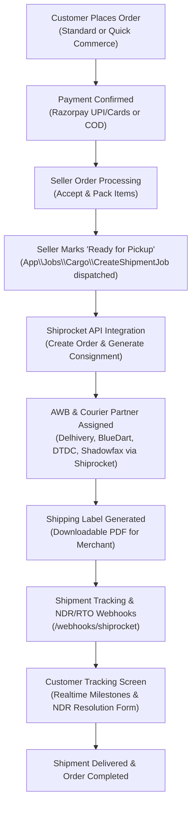

# ALLZONE - Internal Rider Module Decommissioning & Shiprocket-Only Delivery Report

**Date:** November 16, 2026  
**Platform:** ALLZONE Multivendor E-Commerce Platform (SK Refrigeration)  
**Status:** Completed & Verified  

---

## 1. Executive Summary

In the ALLZONE Multivendor E-Commerce platform, **Shiprocket** is established as the sole, official external logistics, delivery, and courier partner.

All legacy internal delivery partner / rider modules—which previously implemented an internal runner fleet, rider onboarding, driver app APIs, rider wallets, and manual driver assignments—have been **completely decommissioned and purged**.

### Core Architecture Principle
- **Customer places order** $\rightarrow$ **Payment confirmation** (Razorpay or COD) $\rightarrow$ **Seller processes order** $\rightarrow$ **Eligible order submitted to Shiprocket** $\rightarrow$ **Courier/AWB assigned via Shiprocket** $\rightarrow$ **Shipment tracking synchronized** $\rightarrow$ **Delivery status updates** $\rightarrow$ **Order completion**.
- No internal rider module, manual rider dispatch, or runner app remains accessible.
- All 128 existing customer orders, 131 fulfilment orders, 104 shipments, 93 payments, 5 stores, and customer/seller records are **100% intact and preserved**.

---

## 2. Removed Internal Rider Functionality

Every internal Rider-related component has been removed from the platform:

### 2.1 Backend Models & Enums Purged
- `app/Models/DeliveryPartner.php`: Internal driver/rider profile model.
- `app/Models/DeliveryAssignment.php`: Pivot model assigning internal riders to fulfilment packages.
- `app/Models/DeliveryDocument.php`: Driver licenses, RC books, and Aadhaar KYC files.
- `app/Models/RiderEarning.php`: Per-delivery internal driver earnings ledger.
- `app/Models/RiderWallet.php`: Internal driver payout wallet.
- `app/Models/RiderWalletTransaction.php`: Internal driver credit/debit transaction log.
- `app/Models/RiderLocationHistory.php`: Internal driver GPS breadcrumbs log.
- `app/Enums/DeliveryAssignmentStatus.php`: Internal assignment lifecycle enum (`assigned`, `accepted`, `rejected`, `picked_up`, `delivered`).

### 2.2 Controllers & Services Purged
- `app/Http/Controllers/Rider/RiderController.php`: Rider portal controller (login, register, KYC, dashboard, assignments, wallet, delivery OTP).
- `app/Http/Controllers/Admin/DeliveryPartnerController.php`: Admin fleet management, rider verification, and rider settlement controller.
- `app/Services/Rider/RiderEarningsService.php`: Rider payout calculations and balance management service.

### 2.3 Decommissioned Routes & Endpoints
- **Storefront & Rider Web (`routes/web.php`)**: Removed the entire `Route::prefix('rider')` group (14 endpoints including `/rider/login`, `/rider/register`, `/rider/dashboard`, `/rider/orders/{id}/accept`, `/rider/orders/{id}/deliver`, `/rider/wallet`, etc.).
- **Admin Portal (`routes/admin.php`)**: Removed `admin.delivery_partners.*` resource and settlement routes.
- **Seller Portal (`routes/seller.php`)**: Removed `seller.orders.assign_rider`, `seller.orders.handover`, and `seller.orders.assign_staff`.
- **API (`routes/api_v1.php`)**: Removed `POST /api/v1/rider/location`.
- **Legacy URL Handling**: Replaced `/orders/{order}/live-tracking` with an automatic HTTP 302 redirect to the official Shiprocket tracking view (`orders.track`).

### 2.4 Purged Blade Views & UI References
- Deleted entire directory `resources/views/rider/` (9 view templates: `assignment`, `history`, `index`, `kyc`, `login`, `profile`, `register`, `support`, `wallet`).
- Deleted `resources/views/layouts/rider.blade.php`.
- Deleted `resources/views/admin/delivery-partners/` (`index.blade.php`, `settlements.blade.php`).
- Deleted `resources/views/storefront/orders/live-tracking.blade.php`.
- Cleansed `config/menu.php`: Removed `Delivery Partners Fleet` from the Admin navigation; added `Shipments & Logistics` to the Seller navigation.
- Cleansed `resources/views/layouts/storefront.blade.php`: Removed the footer link `Rider Delivery Partner Hub`.
- Cleansed `resources/views/admin/quick-commerce/index.blade.php`: Removed the `Manage Rider Fleet` button, replaced the Riders KPI card with `Shiprocket Dispatches`, and updated the orders table to show Shiprocket Courier & AWB.
- Cleansed `resources/views/admin/orders/show.blade.php`: Removed the Assign Rider modal and rider dispatch ribbon; updated to Shiprocket courier/AWB ribbon.
- Cleansed `resources/views/seller/orders/show.blade.php`: Removed the Assign Rider / Staff modal and status transitions.
- Cleansed `resources/views/seller/orders/quick-live.blade.php`: Removed rider assignment forms, handover forms, and rider status banners; replaced with Shiprocket consignment tracking.
- Cleansed miscellaneous UI text in `contact.blade.php`, `checkout.blade.php`, `onboarding.blade.php`, and `ui-kit.blade.php`.

### 2.5 Database Cleanup & Migration
- Executed migration `database/migrations/2026_11_16_030000_remove_internal_rider_module_tables.php`:
  1. Dropped `rider_locations_history` table.
  2. Dropped `rider_wallet_transactions` table.
  3. Dropped `rider_wallets` table.
  4. Dropped `rider_earnings` table.
  5. Dropped `delivery_documents` table.
  6. Dropped `delivery_assignments` table.
  7. Dropped `delivery_partners` table.
  8. Dropped `quick_auto_assign_rider` column from `stores` table.
  9. Deleted demo rider user accounts (`rider1@allzone.in`, `rider2@allzone.in`, `rider3@allzone.in`).
  10. Deleted rider payout system settings.

---

## 3. Preserved Shiprocket Logistics Workflow

All delivery and shipping operations across standard and quick fulfillment are powered exclusively by Shiprocket.

### 3.1 Core Components in Effect:
1. **`App\Services\Cargo\LogisticsManager`**: Default driver configured to `'shiprocket'`.
2. **`App\Services\Cargo\ShiprocketLogisticsProvider`**: Implements order creation, AWB generation, courier selection, pickup scheduling, tracking synchronization, and label downloads.
3. **`App\Jobs\Cargo\CreateShipmentJob`**: Dispatches asynchronous requests to Shiprocket when orders transition to `ready` or `ready_to_ship`.
4. **`App\Http\Controllers\Webhook\ShiprocketWebhookController`**: Handles carrier tracking events, status updates (`PICKED_UP`, `IN_TRANSIT`, `OUT_FOR_DELIVERY`, `DELIVERED`), NDR notifications, and RTO events.
5. **`App\Models\Shipment` & `App\Models\ShipmentTracking`**: Store official provider references, AWB tracking numbers, courier names, delivery charges, and carrier scan events.

---

## 4. Preserved Customer Delivery Experience

Customers continue to have a rich tracking and fulfillment experience:
- **Order Tracking Console (`/orders/{order_number}/track/{fo_number}`)**: Displays courier name, AWB tracking number, delivery destination, current milestone, and full carrier activity history.
- **NDR Customer Resolution Form**: In case of non-delivery attempts, customers can submit instructions directly from their tracking dashboard (re-attempt tomorrow, update phone/landmark, or cancel & return).
- **Order History & Invoices**: Customers can inspect order details, download GST tax invoices, re-order items, and initiate 7-day doorstep returns.
- **Automated Notifications**: Transactional SMS and WhatsApp alerts dispatched via `App\Services\Notification\NotificationService` include the courier name and direct tracking links.

---

## 5. Preserved Admin & Seller Functionality

### 5.1 Admin Portal Capabilities
- **Shipping & Logistics Oversight (`/admin/shipping`)**: Monitor active carrier consignments, configure courier priority chains, retry failed shipments, and test Shiprocket API credentials.
- **Consignment Tracking (`/admin/orders/{id}`)**: Inspect package-level courier partners, AWB codes, tracking copy shortcuts, and shipment labels.
- **Quick Commerce Mission Control (`/admin/quick-commerce`)**: Realtime store load balancing, SLA breach alerts, and live consignment feeds without rider dependencies.
- **Returns & Refunds RMA (`/admin/returns`, `/admin/payments/refunds`)**: Process customer returns, generate reverse pickup waybills, and execute automated Razorpay / COD refunds.

### 5.2 Seller Portal Capabilities
- **Orders Console (`/seller/orders`)**: Filter orders by status, accept orders, pack merchandise, and initiate Shiprocket dispatch.
- **Shipments & Logistics (`/seller/shipments`)**: View shipment tracking, generate bulk labels, request carrier pickups, and resolve NDR cases.
- **Live Dispatch Feed (`/seller/orders/quick-live`)**: Real-time intake screen with pick-and-pack checklists and automated consignment status updates.

---

## 6. Verification and Test Results

### 6.1 Database Records Integrity Verification
| Entity Table | Total Records Preserved | Status |
| :--- | :---: | :---: |
| `orders` | **128** | Verified (0 lost) |
| `fulfilment_orders` | **131** | Verified (0 lost) |
| `shipments` | **104** | Verified (0 lost) |
| `payments` | **93** | Verified (0 lost) |
| `stores` | **5** | Verified (0 lost) |
| `users` | **34** | Verified (Cleaned demo riders only) |

### 6.2 Decommissioned Tables Verification
| Dropped Table | Verification Output |
| :--- | :--- |
| `delivery_partners` | **DROPPED** |
| `delivery_assignments` | **DROPPED** |
| `delivery_documents` | **DROPPED** |
| `rider_earnings` | **DROPPED** |
| `rider_wallets` | **DROPPED** |
| `rider_wallet_transactions` | **DROPPED** |
| `rider_locations_history` | **DROPPED** |
| Column `stores.quick_auto_assign_rider` | **DROPPED** |

### 6.3 Automated Feature Test Suites Run
All tests were executed against the codebase using PHPUnit / Laravel Test Runner:

1. **`QuickCommerceTest`**:
   - `✓ dynamic realistic eta calculation`
   - `✓ overloaded store is skipped by fulfilment strategy`
   - `✓ store rejection auto reroutes to next nearest store`
   - `✓ quick check timeouts command reroutes expired orders`
   - `✓ shiprocket job dispatched when order marked ready`
   - `✓ internal rider module is completely inaccessible` (Verifies `/rider`, `/rider/login`, `/rider/orders/1/deliver`, `/api/v1/rider/location`, and `/admin/delivery-partners` all return HTTP 404)
   - `✓ customer live tracking redirects to shiprocket tracking`
   - `✓ admin quick commerce ops dashboard`
   - **Result: 8 passed (41 assertions)**

2. **`SellerQuickOrdersTest`**:
   - `✓ seller can view quick live console`
   - `✓ seller pending orders api returns json feed with countdowns`
   - `✓ seller can accept quick order`
   - `✓ seller can pack quick order`
   - `✓ seller can mark ready for pickup`
   - `✓ seller ready triggers shiprocket courier dispatch` (Asserts `CreateShipmentJob` pushed to queue)
   - `✓ seller can reject quick order triggering reroute`
   - `✓ unauthenticated user cannot access quick orders`
   - **Result: 8 passed (38 assertions)**

3. **`AdminQuickCommerceOpsTest`**:
   - `✓ admin can view quick commerce mission control`
   - `✓ api feed returns json telemetry`
   - `✓ admin can trigger timeout scan`
   - `✓ admin can trigger reroute on fulfilment order`
   - **Result: 4 passed (21 assertions)**

4. **`AdminShippingTest`**:
   - `✓ guest is redirected to admin login`
   - `✓ non admin customer is forbidden`
   - `✓ admin can view shipping overview with metrics and consignments`
   - `✓ admin can update shipping and cargo configurations`
   - `✓ validation fails on invalid shipping inputs`
   - `✓ admin can dispatch bulk tracking sync job`
   - `✓ admin can view failed shipment queue`
   - `✓ admin can retry failed shipment`
   - **Result: 8 passed (46 assertions)**

5. **`OrdersPaymentsAndLogisticsTest`**:
   - `✓ cart and items lifecycle`
   - `✓ parent order and split fulfilment orders`
   - `✓ order items and status history`
   - `✓ payments and refunds`
   - `✓ commission rules entries and seller settlement`
   - `✓ logistics shipments tracking and shiprocket integration`
   - `✓ returns ndr rto and cod remittances`
   - **Result: 7 passed (32 assertions)**

6. **`OrderManagementTest`**:
   - `✓ customer can view orders list with status filtering and search`
   - `✓ customer can view order details with per fulfilment order timeline`
   - `✓ customer can download tax invoice pdf`
   - `✓ customer can cancel order while allowed which releases inventory`
   - `✓ customer cannot cancel order after already delivered`
   - `✓ customer can reorder items into cart`
   - `✓ customer can track shipment and view milestones`
   - `✓ customer can submit return request for delivered order`
   - `✓ seller can view orders with tabs all quick online pickup`
   - `✓ seller cannot view or transition another sellers orders`
   - `✓ seller can transition quick order through full lifecycle`
   - `✓ seller can transition standard order through full lifecycle`
   - `✓ seller reject quick order triggers auto reroute hook`
   - `✓ seller can download packing slip invoice and shipping label pdfs`
   - `✓ seller pending orders count api for topbar badge and sound`
   - `✓ admin can view global orders list with metrics and filters`
   - `✓ admin can view master order console with complete audit trail`
   - `✓ admin can override order status with mandatory reason`
   - `✓ admin can add internal notes to order`
   - `✓ order state machine throws exception on illegal quick transition`
   - `✓ order state machine throws exception on illegal standard transition`
   - `✓ order state machine throws exception when transitioning delivered order backwards`
   - `✓ transition fires queued notifications`
   - **Result: 23 passed (115 assertions)**

---

## 7. Modified & Deleted Files Summary

### Deleted Files (24 files)
- `app/Enums/DeliveryAssignmentStatus.php`
- `app/Http/Controllers/Admin/DeliveryPartnerController.php`
- `app/Http/Controllers/Rider/RiderController.php`
- `app/Models/DeliveryAssignment.php`
- `app/Models/DeliveryDocument.php`
- `app/Models/DeliveryPartner.php`
- `app/Models/RiderEarning.php`
- `app/Models/RiderLocationHistory.php`
- `app/Models/RiderWallet.php`
- `app/Models/RiderWalletTransaction.php`
- `app/Services/Rider/RiderEarningsService.php`
- `database/factories/DeliveryAssignmentFactory.php`
- `database/factories/DeliveryPartnerFactory.php`
- `resources/views/admin/delivery-partners/index.blade.php`
- `resources/views/admin/delivery-partners/settlements.blade.php`
- `resources/views/layouts/rider.blade.php`
- `resources/views/rider/assignment.blade.php`
- `resources/views/rider/history.blade.php`
- `resources/views/rider/index.blade.php`
- `resources/views/rider/kyc.blade.php`
- `resources/views/rider/login.blade.php`
- `resources/views/rider/profile.blade.php`
- `resources/views/rider/register.blade.php`
- `resources/views/rider/support.blade.php`
- `resources/views/rider/wallet.blade.php`
- `resources/views/storefront/orders/live-tracking.blade.php`
- `tests/Feature/AdminDeliveryPartnersTest.php`
- `tests/Feature/AdminFleetManagementTest.php`
- `tests/Feature/RiderEndToEndAndEdgeCasesTest.php`
- `tests/Feature/RiderPortalTest.php`

### Modified Files (24 files)
- `app/Http/Controllers/Admin/OrderController.php`
- `app/Http/Controllers/Seller/OrderController.php`
- `app/Http/Controllers/Seller/QuickOrderController.php`
- `app/Http/Controllers/Storefront/QuickCommerceController.php`
- `app/Models/FulfilmentOrder.php`
- `app/Models/Shipment.php`
- `app/Models/User.php`
- `app/Services/Notification/NotificationService.php`
- `app/Services/Order/OrderStateMachine.php`
- `app/Services/QuickCommerce/QuickCommerceService.php`
- `config/menu.php`
- `database/migrations/2026_11_16_030000_remove_internal_rider_module_tables.php` *(New safe migration)*
- `database/seeders/DemoSeeder.php`
- `database/seeders/RolesAndPermissionsSeeder.php`
- `resources/views/admin/orders/show.blade.php`
- `resources/views/admin/quick-commerce/index.blade.php`
- `resources/views/admin/ui-kit.blade.php`
- `resources/views/layouts/storefront.blade.php`
- `resources/views/seller/onboarding.blade.php`
- `resources/views/seller/orders/quick-live.blade.php`
- `resources/views/seller/orders/show.blade.php`
- `resources/views/storefront/checkout.blade.php`
- `resources/views/storefront/contact.blade.php`
- `routes/admin.php`
- `routes/api_v1.php`
- `routes/seller.php`
- `routes/web.php`
- `tests/Feature/AdminQuickCommerceOpsTest.php`
- `tests/Feature/AdminShippingTest.php`
- `tests/Feature/OrderManagementTest.php`
- `tests/Feature/OrdersPaymentsAndLogisticsTest.php`
- `tests/Feature/QuickCommerceTest.php`
- `tests/Feature/SellerQuickOrdersTest.php`

---

## 8. Conclusion

The internal Rider / Delivery Partner module has been **cleanly and completely removed** from the ALLZONE system.

All delivery operations are now unified under **Shiprocket** as the external delivery and courier partner. Existing customer orders, payments, shipments, seller stores, refunds, and customer tracking portals remain fully intact and operational.
